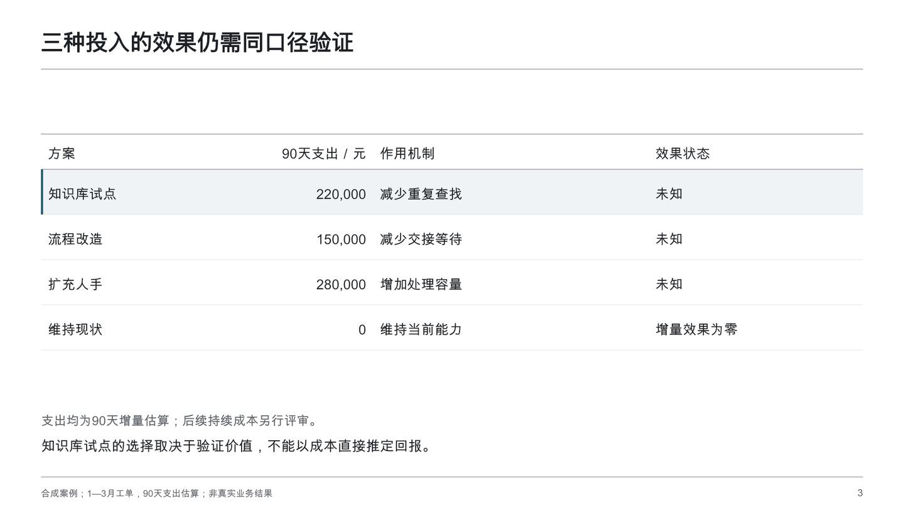
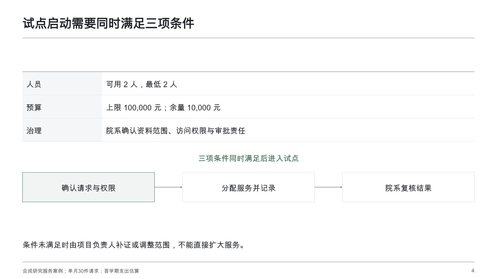
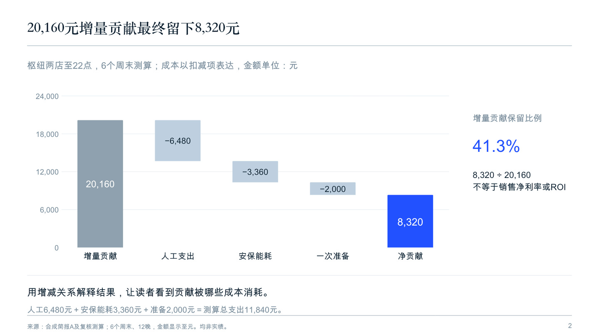

# mckinsey-deck-craft

Turn a decision question and evidence into a consulting-style storyline and editable PowerPoint, drawing on independently studied McKinsey presentations.

[中文](README.md) | **English** · [](https://github.com/kylez0101/mckinsey-deck-craft/actions/workflows/verify.yml)

[Examples](#gallery) · [Capabilities](#capabilities) · [Quick start](#quick-start) · [Prompts](#prompts) · [Workflow](#workflow) · [Customize](#customization) · [Verification](#verification) · [Install](#installation) · [Resources](#resources)

<a id="gallery"></a>
## See the outputs

These synthetic worked examples are in Chinese. They show the current methods and editable objects, not McKinsey deliverables or real business results. Open an image for detail or download its deck.

### SaaS budget decision

[](assets/readme/saas-decision.jpg)

Compare costs and pilot conditions when benefits are unknown, then recheck the recommendation as inputs change.

[Download six-slide PPTX](examples/saas-budget/report.pptx) · [Source data](examples/saas-budget/source.json) · [Storyboard](examples/saas-budget/storyboard.md)

### University shared service

[](assets/readme/university-service.jpg)

Connect service scope to staffing gates, responsibilities and a phased pilot.

[Download six-slide PPTX](examples/university-service/report.pptx) · [Source data](examples/university-service/source.json) · [Storyboard](examples/university-service/storyboard.md)

### Professional charts and tables

[](assets/readme/professional-charts.jpg)

Choose editable ranges, bridges, dumbbells, scatter plots and ledgers for the actual data relationship.

[Download chart library](assets/templates/professional-chart-gallery.pptx) · [Source data](assets/templates/professional-chart-data.json) · [Design guide](references/professional-chart-design.md)

<a id="capabilities"></a>
## What you can do

| Task | Result |
|---|---|
| **Learn** | Explain a source slide's argument, layout, purpose, and limits. |
| **Storyboard** | Plan each slide's role, title, evidence, visual relationship, and transition. |
| **Create** | Build a complete editable deck using the host's available PPT tools. |
| **Review** | Locate issues by slide and evidence, with their impact and suggested fixes. |
| **Edit** | Change selected slides or objects and recheck dependent numbers and conclusions. |

The library includes 18 layout archetypes, 10 base page types, 7 professional chart/table examples, and 6 data layouts. It applies to decision reports, proposals, operating guides, and other topics; manufacturing-specific frameworks are used only where relevant.

<a id="quick-start"></a>
## Quick start

**1. Ask an agent with file and terminal tools to install the full skill:**

```text
Install this skill: https://github.com/kylez0101/mckinsey-deck-craft
Identify the current agent and use its supported user-level or project-level skills location.
Download the entire repository. Keep SKILL.md, references/, assets/, scripts/, schemas/, evals/, and examples/ together.
If an installation already exists, check its origin and preserve local changes first.
Verify that you can read SKILL.md, the PPT templates, and the reference documents.
Then tell me how to invoke it in this agent and which PPT authoring tools are available.
Distinguish a successful download from verified PPT generation.
```

**2. Try the bundled six-slide example:**

```text
Use mckinsey-deck-craft. Read examples/saas-budget/source.json from the installed skill folder to recreate the
six-slide SaaS budget decision example. Preserve the synthetic-data labels,
unknown benefits, and conditional recommendation. Use the host's available
PPT tools. Deliver an editable PPTX, the storyboard, source data, and a check
record. If PPT authoring is unavailable, identify the missing tool and provide
the storyboard and usable templates without claiming a completed PPT.
```

Invoke `/mckinsey-deck-craft` in Claude Code or `$mckinsey-deck-craft` in Codex **chat**, then add your request. Other agents can ask by name. For manual setup, see [full installation](#installation).

Loading the skill needs file access. Creating an editable PPT also needs a working PPT authoring toolchain. A successful install alone does not establish that capability.

<a id="prompts"></a>
## Prompts to adapt

| Need | Copy and adapt |
|---|---|
| A new decision deck | “Use mckinsey-deck-craft. Audience: [who]. Decision: [choice]. Evidence: [files]. Create [N] slides including the cover. Mark unknowns and deliver editable output with a check record.” |
| A single-slide change | “Edit only slide 4: simplify the option comparison and keep its conditions and sources. Preserve other slides. Recheck dependencies and export a new file.” |
| A different theme | “Use a generic brand profile for live presentation, with primary color #8C1515. Use available fonts, then render and check readability.” |
| Changed numbers | “Change Option A to CNY 260,000. Recheck the budget, chart/table values, narrative, and conditional recommendation. Keep the cover unchanged and export a new file.” |
| Review or learning | “Review this deck for unsupported claims and title-to-evidence gaps. Locate each finding by slide.” / “Explain the argument and layout of this source page and when to use it.” |

<details>
<summary><strong>Complete example: an eight-slide customer-service decision report</strong></summary>

After installation, send this prompt. It requests an English deck; the bundled gallery examples above are in Chinese.

```text
Use mckinsey-deck-craft to create “Improving B2B SaaS Customer-Service Productivity”.

Audience: the CEO and head of customer service.
Decision: prioritize knowledge management, process improvement, or more staff over the next 90 days.
Length: 8 slides including the cover. Write the deck in English.

All inputs below are synthetic demonstration data, not observed business facts:
January / February / March tickets: 10,000 / 12,000 / 15,000.
Average resolution time: 12 / 14 / 18 hours.
Repeat-contact share: 18% / 22% / 28%.
Customer satisfaction: 88% / 85% / 80%.
Budget ceiling: CNY 300,000.
Option A: knowledge base and assisted retrieval, CNY 220,000 one-time investment.
Option B: scheduling and process changes, CNY 150,000 one-time investment.
Option C: additional service staff, CNY 280,000 incremental cost over 90 days.
These cost scopes differ. Explain comparability limits; recurring costs, effects, and returns are unknown.

Requirements:
- Use the bundled deep-blue cover artwork with editable white text.
- Use #8C1515 as the body theme's primary color with restrained neutrals.
- Aim for single-line titles, comfortable typography and spacing, and purposeful trends, comparison tables, and timelines.
- Separate observed patterns from root-cause hypotheses. Do not invent savings, staffing reductions, or payback periods.
- Compare costs, risks, dependencies, and evidence gaps. Give a conditional pilot recommendation when evidence is insufficient.
- Sequence: cover, decision summary, trend evidence, root-cause hypotheses, option comparison, pilot gates, 90-day roadmap, budget and decision.
- Check the host's existing authoring tools first; keep key charts and tables editable.
- If PPT generation is available, deliver output/customer-service-plan.pptx and render it again for inspection.
- Also provide the storyboard, source data, and a check record identifying unfinished verification.
- If authoring tools are missing, explain the gap and provide the storyboard and usable templates without claiming a completed PPT.
```

The expected result is an eight-slide report, traceable source data, a storyboard, and a check record. State the basis for proposed thresholds or effects. Replace demonstration inputs with real evidence for an actual engagement.

</details>

<a id="workflow"></a>
## From question to checked deck

1. **Define the decision.** Identify the audience, choice, scope, length, and available evidence.
2. **Separate facts and hypotheses.** Keep sources, dates, units, assumptions, and unknowns explicit; do not transfer old case outcomes into new promises.
3. **Write the storyboard.** Give each slide a job and an evidence-supported title. Read titles in sequence to check the argument.
4. **Choose the visual relationship.** Use comparisons, trends, flows, or plans to fit the evidence. Rebuild editable objects with the host's tools.
5. **Render and verify.** Inspect the exported file, check data and dependent recommendations, and test representative editing and reopening. Record unperformed checks.

Review-only requests return findings; requests that include changes proceed to editing. A single-slide task does not add a cover. See [task modes](references/task-modes.md) and [delivery checks](references/production-checks.md).

<a id="customization"></a>
## Customize the brand and reading context

Set top-level `style` in page JSON, or `presentation.style` in bound source data:

```json
{
  "style": {
    "profile": "generic",
    "purpose": "presentation"
  }
}
```

- `personal` uses the bundled deep-blue cover artwork; `generic` starts with a neutral cover.
- `reading` targets close reading; `presentation` uses larger type and tighter content capacity for live delivery. The default is `personal` / `reading`.
- Fonts, cover, and footer accept explicit overrides. Body colors use the separate `theme` configuration. Check installed fonts and render after changes.

Data-driven updates cover **established bindings only**. Changing bound source data can update calculations, charts, workbooks, tables, text, and recommendation conditions when those fields are connected. Manual PPT edits do not automatically synchronize all content. See [style profiles](references/style-profiles.md), [themes](references/theme-system.md), and [data binding](references/data-binding.md).

<a id="verification"></a>
## Evidence and verification limits

The local suite has **88 tests**. The [completed evaluation record](evals/results/2026-11-07-complete/README.md) documents **24 executions** across 12 tasks: **22 editable decks / 116 slides**, plus **2 text-only handoffs** under constrained tooling.

| Record | Result | What it establishes |
|---|---|---|
| Original judgments | 74 checks passed; 4 evidence/rubric gaps; 0 failed | All 24 executions were completed; the four gaps concerned font evidence and an unstated qualification requirement. |
| After supplementary evidence, rubric clarification, and assisted repairs | 78 passed; 0 remaining gaps; 0 failed | Reassessment of the same runs, including an assisted baseline font repair; this is not a raw model win rate. |

Original judgments and subsequent corrections remain separate. The examples are worked demonstrations, not unseen evaluation tasks. PowerPoint desktop and Google Slides have not been tested; static renders and object checks do not replace target-application verification.

Run portable checks from the repository root:

```sh
node --test scripts/tests/*.test.mjs
node scripts/sync-template-catalog.mjs --check
node scripts/preflight.mjs --input examples/saas-budget/source.json
```

These checks do not require the full PPT runtime. Add `--full` to preflight for runtime, fonts, and Python checks. A build result of `machine_checks_passed` covers its listed machine checks; use `verified` only when all required acceptance checks have evidence. Unperformed checks remain `not_run`.

<a id="installation"></a>
## Full installation and compatibility

<details>
<summary><strong>Manual setup, WorkBuddy upload, and all supported installation routes</strong></summary>

Install the **entire repository**, preserving `SKILL.md`, `references/`, `assets/`, `scripts/`, `schemas/`, `evals/`, and `examples/`. Use a destination that does not already exist. Run the appropriate block in your **system terminal**:

```sh
# Claude Code: user-level installation
mkdir -p ~/.claude/skills
git clone https://github.com/kylez0101/mckinsey-deck-craft.git ~/.claude/skills/mckinsey-deck-craft
```

```sh
# Codex: user-level discovery location
mkdir -p ~/.agents/skills
git clone https://github.com/kylez0101/mckinsey-deck-craft.git ~/.agents/skills/mckinsey-deck-craft
```

Start a new session if needed and confirm discovery. Use `/mckinsey-deck-craft` in Claude Code or `$mckinsey-deck-craft` in Codex chat. Codex does not need a second copy after installation under `~/.agents/skills`. For project-only installation, use the corresponding directory below from the project root.

**WorkBuddy:** Download the [source ZIP](https://github.com/kylez0101/mckinsey-deck-craft/archive/refs/heads/main.zip) using **Code → Download ZIP**, then extract it. In **Experts · Skills · Connectors → Skills → Add Skill → Upload Skill** (Chinese UI: **专家·技能·连接器 → 技能 → 添加技能 → 上传技能**), upload the complete skill folder. The official interface also accepts ZIP packages containing `SKILL.md`; if a ZIP is rejected, use the extracted folder. Confirm discovery, then ask by name. A standalone Markdown upload omits the templates and scripts. Client import has not been tested. [Upload formats](https://main.qcloudimg.com/raw/document/product/pdf/862_129183_cn.pdf) · [Official guide](https://www.codebuddy.cn/docs/workbuddy/From-Beginner-to-Expert-Guide/Function-Description/Skills-Market)

Routes below follow official documentation; version-specific interfaces and permissions can differ. Documentation review does not establish successful authoring in every client.

| Agent | User-level / project-level location | Invoke or confirm | Official guide |
|---|---|---|---|
| Claude Code | `~/.claude/skills/` / `.claude/skills/` | `/mckinsey-deck-craft` | [Docs](https://code.claude.com/docs/en/skills) |
| Codex | `~/.agents/skills/` / `.agents/skills/` | `$mckinsey-deck-craft` or the skill picker | [Docs](https://learn.chatgpt.com/docs/build-skills) |
| Gemini CLI | `~/.gemini/skills/` or `~/.agents/skills/`; corresponding project directories | `/skills list`, then ask by name | [Docs](https://geminicli.com/docs/cli/skills/) |
| Cursor | `~/.cursor/skills/` / `.cursor/skills/`; also `.agents/skills/` | `/mckinsey-deck-craft` or the `@` picker | [Docs](https://cursor.com/help/customization/skills) |
| GitHub Copilot | `~/.copilot/skills/` / `.github/skills/`; also `.agents/skills/` | Ask by name and description | [Docs](https://docs.github.com/en/copilot/how-tos/copilot-on-github/customize-copilot/customize-cloud-agent/add-skills) |
| OpenCode | `~/.config/opencode/skills/` / `.opencode/skills/`; also `.agents/skills/` | Load through its native skill tool | [Docs](https://opencode.ai/docs/skills) |
| CodeBuddy Code | `~/.codebuddy/skills/` / `.codebuddy/skills/` | `/skills`, then `/mckinsey-deck-craft` | [Docs](https://www.codebuddy.cn/docs/cli/skills) |
| TRAE China | `~/.trae-cn/skills/` / `.trae/skills/`; also project `.agents/skills/` | Check settings, then ask by name | [Docs](https://docs.trae.cn/ide_skills) |
| Qoder international CLI | `~/.qoder/skills/` / `.qoder/skills/` | `/skills reload`, then `/mckinsey-deck-craft` | [Docs](https://docs.qoder.com/cli/Skills) |
| Qoder CN IDE | `~/.lingma/skills/` / `.lingma/skills/` | Restart and select from the `/` menu | [Docs](https://docs.qoder.cn/user-guide/skills) |
| Qwen Code | `~/.qwen/skills/` / `.qwen/skills/`; also `.agents/skills/` | `/skills`, then `/mckinsey-deck-craft` | [Docs](https://github.com/QwenLM/qwen-code/blob/main/docs/users/features/skills.md) |
| Kimi Code CLI | `~/.kimi-code/skills/` / `.kimi-code/skills/`; also `.agents/skills/` | `/skill:mckinsey-deck-craft`; confirm discovery for your version | [Docs](https://www.kimi.com/code/docs/en/kimi-code-cli/customization/skills.html) |

On Windows, use Git Bash or download the ZIP and install with File Explorer; `~` means your user home, usually `C:\Users\your-name`.

For another host, use its documented custom-skill import. If it has workspace file access but no skill discovery, put the full folder in the workspace and ask:

```text
Read ./mckinsey-deck-craft/SKILL.md first. Load references/ only as needed,
use the templates and assets, and follow the skill's workflow.
Check your available PPT tools and use them to produce editable output.
```

</details>

### FAQ

**Can every agent produce a PPT after installation?** No. Reading and storyboarding need file access; PPT authoring needs an existing presentation skill, API, or usable script toolchain. Chat-only interfaces cannot be assumed to produce an editable file.

**Do I need the Codex runtime?** Only for the bundled full PPT builders, which require the Codex Presentations runtime, Artifact Tool, and Python with lxml. Other hosts should use their existing PPT tools. Modern Node.js can run portable data compilation, themes, tests, and `--dry-run`; installing packages alone does not enable the full builder. See [compatibility](references/agent-compatibility.md).

**Can it write English slides?** Yes: request the output language. Most operational references are currently in Chinese; the agent can explain them while producing English deliverables.

<a id="resources"></a>
## Resources and attribution

- **Start:** [SKILL.md](SKILL.md) · [Learning guide](references/learning-guide.md) · [Task modes](references/task-modes.md)
- **Build:** [Storylines](references/storyline-patterns.md) · [Layouts](references/layout-patterns.md) · [Editable templates](references/editable-templates.md) · [Professional charts](references/professional-chart-design.md)
- **Adapt:** [Style profiles](references/style-profiles.md) · [Themes](references/theme-system.md) · [Data binding](references/data-binding.md) · [Cross-agent compatibility](references/agent-compatibility.md)
- **Check:** [Quality rubric](references/quality-rubric.md) · [Delivery checks](references/production-checks.md) · [Evaluation method](references/evaluation.md) · [Completed run record](evals/results/2026-11-07-complete/README.md)
- **Inspect:** [Template contract](schemas/template-contract.json) · [Source map](references/corpus-map.md) · [SaaS example](examples/saas-budget/README.md) · [University example](examples/university-service/README.md)

This is an independent research and reuse skill, not an official McKinsey product or specification. Its observations come from the mapped presentations and do not establish McKinsey's complete internal methods. Original source PPTs are not distributed; file identifiers, page maps, hashes, and inference boundaries are recorded in the [source map](references/corpus-map.md).

Images and icons retain their provenance. Third-party materials remain the property of their respective rights holders; this repository grants no additional rights to them.

README presentation structure references [Awesome-PPT-Design-Skills](https://github.com/software-ai-life/Awesome-PPT-Design-Skills). Preview images come from this repository's actual worked examples.
