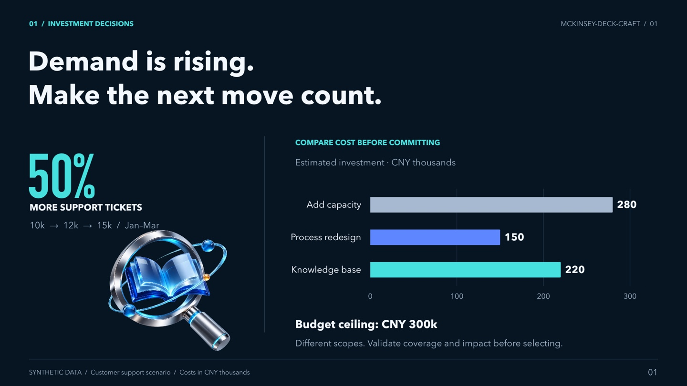
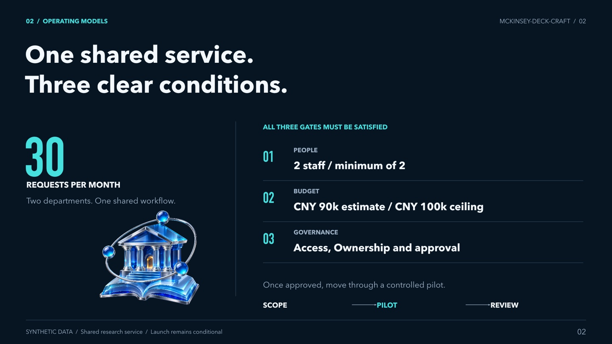
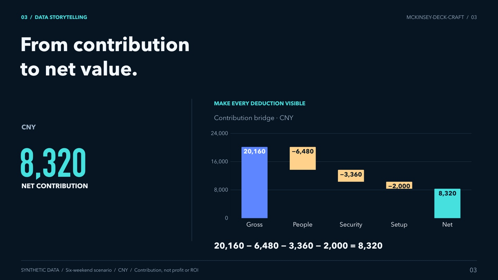

# mckinsey-deck-craft

**从决策问题出发，组织证据与故事线，制作可编辑 PPT。**

参考真实咨询案例，把资料整理成适合受众的报告、图表与行动建议。支持自定义品牌、统一源数据更新，以及对现有 PPT 的审查和局部修改。

**中文** | [English](README.en.md) · [](https://github.com/kylez0101/mckinsey-deck-craft/actions/workflows/verify.yml)

[成品画廊](#gallery) · [快速开始](#quick-start) · [常用提示词](#prompts) · [安装详情](#installation) · [验证记录](#verification)

个人研究与复用 Skill，非麦肯锡官方产品。以下案例均使用合成数据。

<a id="gallery"></a>
## 1. 成品画廊

预览来自仓库内的可编辑合成案例。点击图片查看大图，或下载PPTX检查原生对象。

### SaaS 客服投入决策

[](assets/readme/saas-decision.jpg)

在收益未知时比较投入、预算与试点条件。

[下载6页PPTX](examples/saas-budget/report.pptx) · [源数据](examples/saas-budget/source.json) · [故事板](examples/saas-budget/storyboard.md)

### 高校共享服务试点

[](assets/readme/university-service.jpg)

把服务范围、人员门槛和交接责任放在同一套报告中。

[下载6页PPTX](examples/university-service/report.pptx) · [源数据](examples/university-service/source.json) · [故事板](examples/university-service/storyboard.md)

### 专业图表与表格

[](assets/readme/professional-charts.jpg)

表达情景区间、贡献桥、哑铃比较、资源占用与方案取舍。

[下载图表库](assets/templates/professional-chart-gallery.pptx) · [示例数据](assets/templates/professional-chart-data.json) · [选型说明](references/professional-chart-design.md)

<a id="capabilities"></a>
## 2. 你可以用它做什么

| 你的需求 | 交付结果 |
|---|---|
| 根据资料制作报告 | 组织决策问题、证据、逐页故事线，生成可编辑 PPT |
| 先确定结构 | 交付逐页故事板，列明标题、证据、视觉关系和待补资料 |
| 审查现有 PPT | 定位具体页面的问题，解释影响与修改建议 |
| 只改一页或一组数字 | 保留未涉及内容，核对相关图表、文字与建议 |
| 学习咨询式表达 | 对照原样本解释页面职责、论证方式与适用边界 |

关键图表、表格与需修改的图示使用原生对象。样本来自数字制造与运营转型，新主题重新定义行业事实、指标和实施条件。

<a id="quick-start"></a>
## 3. 快速开始

### 第一步：安装完整 Skill

把下面这段发给能访问 GitHub、读写本地文件的 Agent：

```text
请安装这个 Skill：https://github.com/kylez0101/mckinsey-deck-craft
识别当前 Agent，使用它支持的用户级或项目级技能目录。
下载完整仓库，保留 SKILL.md、references/、assets/、scripts/、schemas/、evals/、examples/ 的相对结构。
已有同名安装时保留本地修改。
安装后确认资源齐全，说明调用方式和当前可用的 PPT 制作工具。
```

Claude Code 用 `/mckinsey-deck-craft`，Codex 用 `$mckinsey-deck-craft`。其他 Agent 可直接在请求中指定名称。[手动安装与 WorkBuddy 上传](#installation)

### 第二步：用现有案例试一次

```text
请使用 mckinsey-deck-craft，读取该Skill安装目录中的 examples/saas-budget/source.json，
为董事会和客服负责人制作6页中文客服投入决策PPT，包含封面。
保留合成数据、未知收益和试点条件，交付可编辑文件并检查最终渲染。
```

也可以直接下载画廊中的成品查看。生成 PPT 需要宿主已有的演示文稿工具；只有文本能力时，可交付故事板与后续制作材料，并说明尚未完成的部分。

<a id="prompts"></a>
## 4. 常用提示词

| 想做什么 | 可直接使用的请求 |
|---|---|
| 从新资料制作 | `请使用 mckinsey-deck-craft，根据这份资料制作8页中文决策报告（含封面），受众是管理层，说明可选方案、证据与待确认条件。` |
| 先写故事板 | `先给逐页故事板，列出每页任务、标题、证据和缺项，暂不生成PPT。` |
| 局部修改 | `只修改第4页的方案比较，保留其他页面内容与顺序，不增加封面；同步核对受影响的数字与结论。` |
| 更换品牌 | `使用通用品牌配置，正文主色为#8C1515，封面另行设计，选择实际可用字体，输出适合现场演示的版本。` |
| 改数后重判 | `把SaaS示例预算从30万元改为20万元，重新检查余量、图表、比较表和试点建议，保持封面，输出一个新文件。` |

<details>
<summary>展开：带完整演示数据的8页请求</summary>

```text
请使用 mckinsey-deck-craft，制作《B2B SaaS 客服效率提升方案》。

受众：CEO 与客服负责人。
要支持的决定：未来90天，优先投入知识库、流程改造，还是扩充人手。
总页数：8页，包含封面；正文用中文。

下面全部是演示数据，不是真实业务事实：
1月/2月/3月工单数：10,000 / 12,000 / 15,000。
平均解决时长：12 / 14 / 18小时。
重复咨询占比：18% / 22% / 28%。
客户满意度：88% / 85% / 80%。
预算上限：30万元。
方案A：知识库与辅助检索，一次性投入22万元。
方案B：排班与流程改造，一次性投入15万元。
方案C：扩充客服团队，90天新增成本28万元。
这些成本覆盖范围不同，先标明可比性限制；后续持续成本、效果和回报未知。

要求：
- 封面用 Skill 自带的深蓝背景和可编辑白字。
- 正文主色为 #8C1515，围绕主色与中性色设计，保持克制。
- 标题尽量单行，字号和留白舒适；按关系使用趋势图、比较表和时间计划。
- 观察到的现象与根因假设分开。不得编造收益、节省人数或回收期。
- 比较三个方案的成本、风险、依赖和待验证项；证据不足时给有条件的试点建议。
- 组织为：封面、决策摘要、趋势证据、根因假设、方案比较、试点门槛、90天计划、预算与决策。
- 先检查可用制作工具，选用宿主现有的原生 PPT 能力；关键图表与表格可编辑。
- 如果支持自动生成，交付 output/customer-service-plan.pptx，并重新渲染检查。
- 同时交付故事板、源数据和检查记录，说明尚未完成的验证。
- 如果缺少 PPT 工具，如实说明缺项并交付故事板和可用模板，不把它们说成完成的PPT。
```

预期得到：一份基于明确演示数据的 8 页报告、可追溯的源数据、故事板和检查记录。任何试点阈值或预期效果都应说明来源；本例没有提供的业务事实保持未知。需要真实项目时，用实际资料替换演示输入。

**后续修改示例：** `把方案A投入改为26万元，重新检查预算、比较表、正文和有条件的推荐；保持封面不变，输出一个新文件。` 数据联动仅覆盖已建立绑定的内容；手工改 PPT 不会让整篇自动同步。

</details>

<a id="workflow"></a>
## 5. 从问题到成品

1. **明确决定。** 确认受众、要支持的判断或行动、篇幅和已有资料。
2. **组织证据。** 区分事实、目标、测算与未知，保留来源、单位、周期和适用条件。
3. **写逐页故事板。** 让标题与正文支持同一判断，各页衔接清楚。
4. **制作可编辑对象。** 依据比较、趋势、流程或取舍选择图表与版式。
5. **检查最终文件。** 从导出文件重新渲染，核对内容、版式、工作簿和代表性编辑行为。

缺少关键事实时保留未知与补证计划。只要故事板的任务，到故事板为止；已要求修改的任务，按指定范围实施。[任务模式](references/task-modes.md)

<a id="customization"></a>
## 6. 图表、主题与数据更新

| 能力 | 你可以控制什么 | 说明 |
|---|---|---|
| 主题与品牌 | 主色、辅助色、字体、封面、页脚 | [主题系统](references/theme-system.md) · [样式配置](references/style-profiles.md) |
| 阅读场景 | 近距离阅读或现场演示 | `reading` / `presentation` 调整字号与容量，实际显示仍需检查 |
| 分析关系 | 比较、趋势、情景区间、成本桥、流程、方案表 | [专业图表](references/professional-chart-design.md) · [数据布局](references/data-layouts.md) |
| 统一源数据 | 同步已绑定的图表、表格、文字、标题与推荐 | [数据绑定](references/data-binding.md)，条件变化后重新判断建议 |

默认 `personal` / `reading` 保留个人深蓝封面和阅读排版；`generic` 提供中性品牌起点。统一源数据输入时，样式放在 `presentation.style`，正文主色放在 `presentation.theme`。

直接在 PowerPoint 手工改数，仍需同步相关文字与表格；整篇联动覆盖已建立的源数据绑定。

<a id="verification"></a>
## 7. 验证与评测

| 已有证据 | 范围 |
|---|---|
| **88项本地测试通过** | 数值、绑定、图表、样式、字段契约、验收与评审包；其中2项需实际演示运行库，便携CI中跳过 |
| **24次任务执行完成** | 22份可编辑PPT共116页，另有2份受限环境文本交付 |
| **原始与修复结果分别保留** | 首轮74项检查通过、4项待补证或澄清；补证、标准澄清及辅助修复后78项通过 |

[完整评测与成品证据](evals/results/2026-11-07-complete/README.md) · [评测方法](references/evaluation.md) · [成品检查](references/production-checks.md)

这些结果限于已记录的任务与环境。修复后通过率不能当作未辅助的模型性能或普遍质量优势。PowerPoint桌面与Google Slides行为仍未实测；机器构建通过、视觉检查、编辑重开和目标应用检查分别记录。

<a id="installation"></a>
## 8. 安装、环境与常见问题

**三种常用入口：** Claude Code 和 Codex 安装到对应技能目录；WorkBuddy 下载源码 ZIP、解压后上传完整技能文件夹。安装成功与能否生成PPT分别确认。

<details>
<summary>展开：Claude Code、Codex、WorkBuddy及其他平台的完整安装说明</summary>

### Claude Code / Codex 手动安装

在**系统终端**执行相应命令，目标文件夹应尚不存在：

```sh
# Claude Code：用户级安装
mkdir -p ~/.claude/skills
git clone https://github.com/kylez0101/mckinsey-deck-craft.git ~/.claude/skills/mckinsey-deck-craft
```

```sh
# Codex：当前官方用户级发现目录
mkdir -p ~/.agents/skills
git clone https://github.com/kylez0101/mckinsey-deck-craft.git ~/.agents/skills/mckinsey-deck-craft
```

随后在 Agent 内确认技能出现；必要时开启新会话。Claude Code 输入 `/mckinsey-deck-craft`，Codex 输入 `$mckinsey-deck-craft`。这些是**聊天里的调用方式**，不是终端命令。安装到 `~/.agents/skills` 后，无需再为 Codex 复制到第二个目录。

### WorkBuddy：下载后上传

1. 下载 [最新源码 ZIP](https://github.com/kylez0101/mckinsey-deck-craft/archive/refs/heads/main.zip)。也可在仓库页面点 **Code → Download ZIP** 获取源码。
2. 解压源码 ZIP，定位包含 `SKILL.md` 的完整技能文件夹。在 WorkBuddy 打开 **专家·技能·连接器 → 技能 → 添加技能 → 上传技能**，上传该文件夹并完成导入；如使用 ZIP 导入，仍需确认入口能识别技能根目录。保持 `SKILL.md` 与 `references/`、`assets/`、`scripts/`、`schemas/`、`evals/`、`examples/` 同级。
3. 在“已安装”中确认技能出现，再输入：`请使用 mckinsey-deck-craft，为我制作一份客服效率提升方案。`

WorkBuddy 的自定义技能走上传入口；不要假定把 GitHub 链接贴进市场对话就会自动安装。安装后确认资源目录齐全，WorkBuddy 客户端导入尚未实测。单独上传 `.md` 会遗漏本 Skill 的模板和脚本，应使用完整包；开放平台的上架元数据规范不等于本地导入规范。[上传格式说明](https://main.qcloudimg.com/raw/document/product/pdf/862_129183_cn.pdf) · [官方指引](https://www.codebuddy.cn/docs/workbuddy/From-Beginner-to-Expert-Guide/Function-Description/Skills-Market)

### 其他 Agent 安装位置

把**完整仓库文件夹**放入对应目录，而非只复制 `SKILL.md`。下面是官方文档规定的发现位置；具体版本的入口和权限可能有差异。

| Agent | 用户级目录 / 项目级目录 | 调用或确认方式 | 官方说明 |
|---|---|---|---|
| Claude Code | `~/.claude/skills/` / `.claude/skills/` | `/mckinsey-deck-craft` | [文档](https://code.claude.com/docs/en/skills) |
| Codex | `~/.agents/skills/` / `.agents/skills/` | `$mckinsey-deck-craft`，或在技能列表选择 | [文档](https://learn.chatgpt.com/docs/build-skills) |
| Gemini CLI | `~/.gemini/skills/` 或 `~/.agents/skills/`；项目对应同名隐藏目录 | `/skills list` 确认，再自然语言调用 | [文档](https://geminicli.com/docs/cli/skills/) |
| Cursor | `~/.cursor/skills/` / `.cursor/skills/`；也支持 `.agents/skills/` | `/mckinsey-deck-craft` 或 `@` 选择 | [文档](https://cursor.com/help/customization/skills) |
| GitHub Copilot | `~/.copilot/skills/` / `.github/skills/`；也支持 `.agents/skills/` | 用名称和任务描述明确要求使用 | [文档](https://docs.github.com/en/copilot/how-tos/copilot-on-github/customize-copilot/customize-cloud-agent/add-skills) |
| OpenCode | `~/.config/opencode/skills/` / `.opencode/skills/`；也支持 `.agents/skills/` | 自然语言要求用原生 skill 工具加载 | [文档](https://opencode.ai/docs/skills) |
| CodeBuddy Code | `~/.codebuddy/skills/` / `.codebuddy/skills/` | `/skills` 确认，`/mckinsey-deck-craft` 调用 | [文档](https://www.codebuddy.cn/docs/cli/skills) |
| TRAE 中国版 | `~/.trae-cn/skills/` / `.trae/skills/`；也支持项目 `.agents/skills/` | 设置中查看，再自然语言调用；优先完整目录复制 | [文档](https://docs.trae.cn/ide_skills) |
| Qoder 国际 CLI | `~/.qoder/skills/` / `.qoder/skills/` | `/skills reload` 后用 `/mckinsey-deck-craft` | [文档](https://docs.qoder.com/cli/Skills) |
| Qoder CN IDE | `~/.lingma/skills/` / `.lingma/skills/` | 重启后在 `/` 菜单选择 | [文档](https://docs.qoder.cn/user-guide/skills) |
| Qwen Code | `~/.qwen/skills/` / `.qwen/skills/`；也支持 `.agents/skills/` | `/skills` 确认，`/mckinsey-deck-craft` 调用 | [文档](https://github.com/QwenLM/qwen-code/blob/main/docs/users/features/skills.md) |
| Kimi Code CLI | `~/.kimi-code/skills/` / `.kimi-code/skills/`；也支持 `.agents/skills/` | `/skill:mckinsey-deck-craft`；版本不同先查技能列表 | [文档](https://www.kimi.com/code/docs/en/kimi-code-cli/customization/skills.html) |

例如，只在某个项目使用 Claude Code 时，在该项目根目录克隆到 `.claude/skills/mckinsey-deck-craft`。Windows 可用 Git Bash 执行上述命令，或下载 ZIP，将 `~` 替换为用户主目录（通常为 `C:\Users\你的用户名`）后通过文件管理器安装。

其他 Agent 若支持自定义 Skills，使用其官方技能导入入口；若不支持自动发现，但能读取工作区文件，将仓库放入工作区并明确要求：

```text
先阅读 ./mckinsey-deck-craft/SKILL.md，按任务需要读取其 references/，
使用 assets/ 中的模板和资源，执行这个 Skill 的工作流程。
请用你当前可用的 PPT 工具生成可编辑文件；先核对工具是否可用。
```

纯聊天网页若无法读取文件夹或执行工具，只能使用提供给它的内容进行写作与故事板分析，不能保证生成可编辑 PPT。更多执行规则见[跨 Agent 兼容说明](references/agent-compatibility.md)。

</details>

<details>
<summary>展开：制作能力与运行环境</summary>

| 使用层级 | 所需能力 | 结果 |
|---|---|---|
| 方法、故事板、审查 | Agent 能读 Markdown 和相关资源 | 结构、观点、证据组织与设计建议 |
| 使用现成模板 | 能打开 PowerPoint 文件的工具 | 直接编辑三套原生模板库 |
| 跨 Agent 制作 PPT | 宿主已有 PPT 技能、演示 API 或可用脚本工具链 | 按本 Skill 的方法重建可编辑对象；需验证实际输出 |
| 数据编译、配色、布局测试 | 支持 ES modules 和 `node:test` 的现代 Node.js | 可执行计算、主题、测试和 `--dry-run` |
| 仓库内完整自动构建器 | Codex Presentations runtime、Artifact Tool、Python + lxml | 运行 `build-deck.mjs` / `build-data-deck.mjs` 生成并验证 PPT |

没有 Codex 运行环境的 Claude Code、WorkBuddy 等，应优先使用宿主已有的 PPT 能力；无需为阅读或使用模板配置 Codex。仓库内完整构建脚本不是只执行 `npm install` 即可运行的独立生成器。环境变量与替代路径见[兼容说明](references/agent-compatibility.md)。字体缺失时选择可用字体并重新验证排版，不能假定不同系统效果相同。

</details>

### 常见问题

**装好后为什么只能输出大纲？** 当前 Agent 还需可用的 PPT 制作工具。Skill 提供方法、资源与可选构建器；完整脚本使用文档说明的 Codex 运行环境，其他宿主可使用自己的演示工具。[兼容说明](references/agent-compatibility.md)

**能把制造业案例换成其他行业吗？** 可以迁移问题、证据、机制与行动的关系；新行业的数据、术语、收益和人员配置需要重新取得依据。

**可编辑是否代表手改后全篇自动同步？** 原生对象可继续修改；全篇更新依赖已建立的源数据绑定和重建流程。

**下载后能用于真实决策吗？** 现有案例用于说明方法和表达。替换为真实资料后，仍需核对来源、成本口径、审批条件与目标应用中的实际显示。

<a id="resources"></a>
## 9. 资源索引与来源

| 资源 | 入口 |
|---|---|
| 更新与案例索引 | [变更记录](CHANGELOG.md) · [案例目录](examples/README.md) |
| 执行入口与任务分支 | [SKILL.md](SKILL.md) · [任务模式](references/task-modes.md) |
| 故事线与视觉方法 | [故事线](references/storyline-patterns.md) · [视觉系统](references/visual-system.md) · [原样本版式](references/layout-patterns.md) |
| 原生模板与图表 | [基础页面库](assets/templates/consulting-page-library.pptx) · [专业图表库](assets/templates/professional-chart-gallery.pptx) · [数据布局库](assets/templates/data-layout-library.pptx) |
| 整套案例 | [SaaS决策](examples/saas-budget/README.md) · [共享服务](examples/university-service/README.md) |
| 学习与来源边界 | [学习指南](references/learning-guide.md) · [样本索引](references/corpus-map.md) |

<details>
<summary>展开：源码与验证命令</summary>

在仓库根目录运行：

```sh
node --test scripts/tests/*.test.mjs
node scripts/sync-template-catalog.mjs --check
node scripts/preflight.mjs --input examples/saas-budget/source.json
```

`scripts/` 包含编译、主题、布局、预检与验收工具；`schemas/template-contract.json` 是字段与容量的结构化定义。测试与默认预检可脱离完整PPT运行环境；`--full` 另查实际运行库、字体与Python。

</details>

本项目为个人归纳，非麦肯锡官方产品。原始PPT不随仓库分发；素材来源、页序、哈希与归纳边界见样本索引，第三方素材归原权利人。

README展示结构参考 [Awesome-PPT-Design-Skills](https://github.com/software-ai-life/Awesome-PPT-Design-Skills)。画廊使用本仓库实际成品预览。
